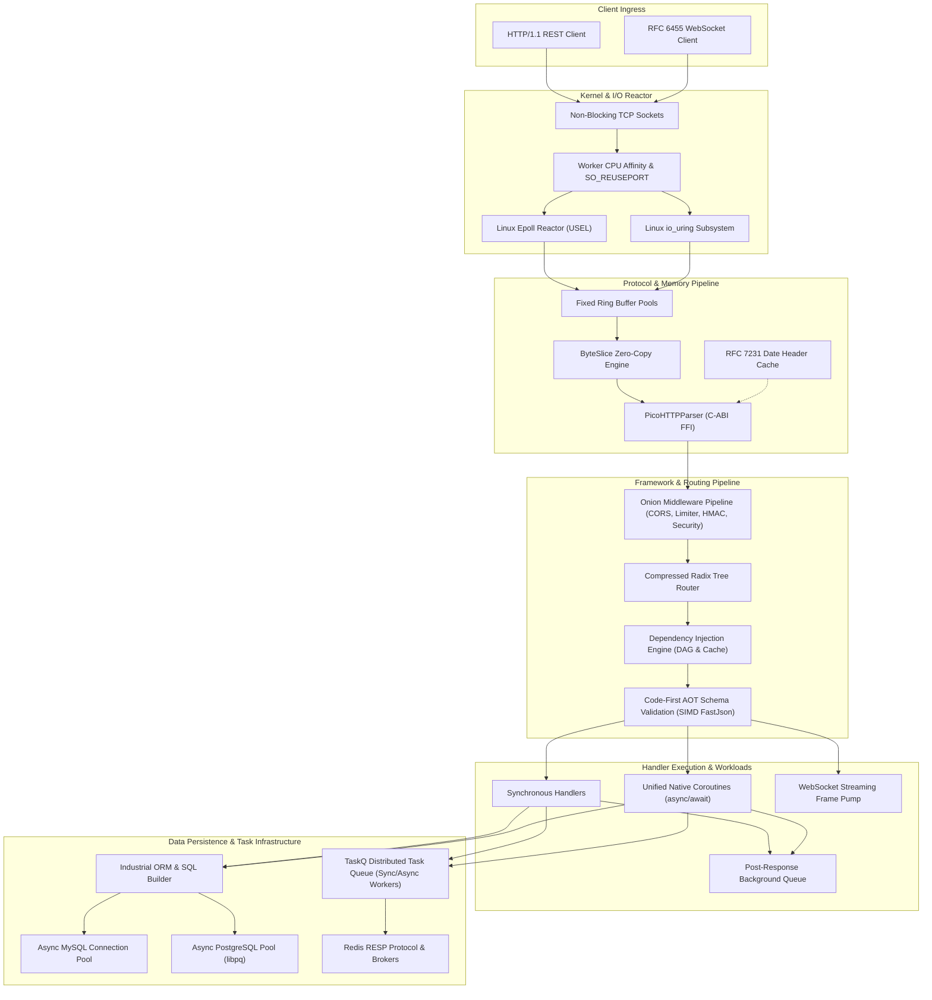

# CodonWeb Architectural Deep Dive

> **High-Performance, Native-Compiled Web Runtime & Framework for Codon (LLVM)**

CodonWeb is an ahead-of-time (AOT) compiled web framework designed for mission-critical, ultra-low-latency backend services. By compiling directly to native machine code via LLVM, CodonWeb achieves C/C++ and Rust-level execution efficiency while preserving Pythonic elegance and developer ergonomics.

---

## 1. High-Level Architecture

The following diagram illustrates the complete end-to-end request lifecycle and subsystem integration:



---

## 2. Zero-Copy Memory Model (`ByteSlice`)

Traditional dynamic web runtimes allocate dozens of intermediate string and dictionary objects for every single HTTP request: URL decoding, path segments, header parsing, and query strings. In high-concurrency workloads, this triggers severe garbage collection pauses and CPU L1/L2 cache thrashing.

### Zero-Allocation Slicing
CodonWeb uses `ByteSlice` (`src/memory/slice.codon`) directly over native linear TCP socket buffers:

- **Pointer Windows**: Slicing an HTTP buffer does not duplicate byte sequences. It instantiates a lightweight struct containing only `(data: Ptr[byte], len: int)`.
- **Deferred Materialization**: Conversions to native integers, floats, or strings only occur if a route handler explicitly accesses typed path/query parameters.
- **Zero-Allocation Routing**: The Radix Tree router matches incoming URI paths directly against byte slices without creating string objects.

---

## 3. Asynchronous I/O Engines

CodonWeb provides two native I/O reactor backends designed specifically for Linux kernel scalability:

### 3.1. Unified Single Event Loop (USEL) & Epoll
- **Direct Syscalls**: Calls `epoll_create1(EPOLL_CLOEXEC)`, `epoll_ctl`, and `epoll_wait` directly through native C wrappers.
- **Edge-Triggered (EPOLLET) with Non-Blocking Sockets**: Maximizes I/O batching and eliminates thundering herd effects.
- **Unified Loop Architecture**: Network I/O, timer queues (min-heap), coroutine resumption, and background job polling run within a single event loop iteration, eliminating cross-thread synchronization overhead.
- **CPU Affinity & Multi-Process Scaling**: Workers bind to dedicated physical CPU cores (`pthread_setaffinity_np`), leveraging `SO_REUSEPORT` for kernel-level connection balancing.

### 3.2. Linux `io_uring` Asynchronous Subsystem
For modern Linux kernels (5.1+), CodonWeb integrates `io_uring`:
- **Submission & Completion Queue Rings (SQ / CQ)**: Submits zero-syscall read and write requests directly to the kernel ring buffer.
- **Registered Buffers & Fixed Files**: Pre-registers memory pages and socket file descriptors with the kernel, bypassing kernel memory mapping overhead on every I/O event.

---

## 4. Ultra-Fast HTTP Parsing: PicoHTTPParser

Rather than relying on interpreted or recursive-descent parsers, CodonWeb integrates [picohttpparser](https://github.com/h2o/picohttpparser) via native C calling conventions:
- **SIMD Vectorization**: Scans HTTP delimiters (`\r\n`, `:`, spaces) using SSE4.2 / AVX2 vector intrinsics.
- **Single-Pass Parsing**: HTTP method, URI, minor version, and up to 64 headers are parsed in under 100 nanoseconds.
- **RFC 7231 Cached Timestamp**: A dedicated thread updates the HTTP `Date` header string once per second in shared memory, saving thousands of `strftime` calls per second.

---

## 5. SIMD FastJson Engine (C-ABI yyjson)

JSON serialization and deserialization represent over 60% of CPU cycles in modern microservices. CodonWeb embeds [yyjson](https://github.com/ibireme/yyjson), one of the fastest ANSI C JSON libraries in existence:
- **Direct C-ABI Linking**: Links with `libcfastjson.a` directly into the LLVM compilation pipeline without Python object wrappers or reference-counting overhead.
- **SIMD Floating-Point & String Extraction**: Numbers and escaped UTF-8 strings are read with SIMD vector instructions.
- **Performance**: Delivers **6.67M ops/sec** (load) and **8.33M ops/sec** (dump) on typical Web API payloads, reaching 2.4 - 3.1 GB/s data processing rates.

---

## 6. Code-First Ahead-of-Time (AOT) Schema Engine

CodonWeb pioneers a **Code-First AOT Schema** compilation paradigm (`src/schema/`):

```
+------------------------------------+
|  class UserCreate(BaseModel):     |
|      username: str = StrField(...) |  <-- Clean, declarative Python code
|      age: int = IntField(...)      |
+------------------------------------+
                 |
        [make codegen]
     (AST Parser + Jinja2)
                 v
+------------------------------------+
|  @extend class UserCreate:         |
|      def from_json_doc(...)        |  <-- Injected zero-copy SIMD parser
|      def _write_json_fields(...)   |  <-- Direct buffer writer
|      def to_response(422)          |  <-- RFC 7807 structured errors
+------------------------------------+
                 |
      [codon build -release]
                 v
       Native Native Machine Code (LLVM)
       (Zero reflection, zero runtime dictionary lookups)
```

### Key Engineering Invariants:
1. **Double-Key Verification**: Auto-discovery verifies that schemas inherit from `BaseModel`/`SchemaModel` AND explicitly import from `codon_web` or `src.schema`, preventing naming collisions with external ORMs.
2. **Deterministic Checksum Protection**: The codegen engine hashes the generated block. User-written model classes and business logic hooks (`custom_validate`) are 100% preserved.
3. **Structured 422 Errors**: When validation fails, CodonWeb immediately outputs RFC 7807 compliant error details:
   ```json
   {
     "detail": [
       {"loc": ["age"], "msg": "Input should be greater than or equal to 0", "type": "greater_than_equal"}
     ]
   }
   ```

---

## 7. Radix Tree Routing & Parameter Extraction

URL routing is implemented as a compressed prefix tree (Radix / Patricia Trie):
- **Logarithmic Time Complexity**: Lookup performance is $O(k)$ where $k$ is the path length, completely unaffected by whether the application has 10 or 10,000 registered routes.
- **Dynamic Parameter Extraction**: Captures path segments (`/items/{id:[0-9]+}`) during tree traversal without backtracking regex engines.
- **Group Prefixing & Scoped Middlewares**: `RouterGroup` allows cascading middleware stacks, nested prefixes, and per-group security guards.

---

## 8. Onion Middleware Pipeline

CodonWeb executes middlewares in a bidirectional onion architecture:

```
Request  ---> [ SecurityHeaders ] ---> [ RateLimiter ] ---> [ CORS ] ---> [ Route Handler ]
Response <--- [ SecurityHeaders ] <--- [ RateLimiter ] <--- [ CORS ] <--- [ Response Data ]
```

### Built-in Middlewares:
- `RecoveryMiddleware`: Traps runtime errors, generates structured 500 responses, and logs stack traces without terminating worker processes.
- `CORSMiddleware`: Handles RFC 6454 cross-origin requests, credential allowance, and preflight `OPTIONS` caching.
- `RateLimiterMiddleware`: Token-bucket and sliding-window rate limiting with per-IP state tracking.
- `SecurityHeadersMiddleware`: Enforces `HSTS`, `X-Content-Type-Options: nosniff`, `X-Frame-Options: DENY`, and CSP.
- `SignedCookieSessionMiddleware`: Cryptographically tamper-proof sessions using HMAC-SHA256 signatures.
- `RequestIdMiddleware`: Generates and propagates `X-Request-ID` tracing identifiers.
- `TimingMiddleware`: Injects microsecond-accurate execution timestamps via `X-Process-Time`.
- `HTTPSRedirectMiddleware` & `TrustedHostMiddleware`: Guards against HTTP Host poisoning and unencrypted traffic.

---

## 9. Industrial ORM & SQLAlchemy-Style SQL Builder

CodonWeb includes a native compiled ORM and SQL Expression Engine (`src/orm/`):

### Dialect Abstraction
- **MySQL Dialect**: Generates backtick identifiers (`` `users`.`id` ``) and `?` positional parameters.
- **PostgreSQL Dialect**: Generates ANSI double-quoted identifiers (`"users"."id"`) and `$1, $2` numbered placeholders.

### Expression Builder
Provides fluent, declarative query composition with compile-time type safety:
```python
stmt = (
    select(table.id, table.username, table.email)
    .select_from(table)
    .where(table.status == "ACTIVE", table.age >= 18)
    .order_by(table.id.desc())
    .limit(20)
)
sql, params = stmt.to_sql(dialect)
```

---

## 10. Native Asynchronous Database Drivers

CodonWeb provides native, non-blocking database drivers without Python runtime dependencies:

### 10.1. Native MySQL Driver
- Complete wire protocol implementation supporting binary handshake, packet sequencing, column definition extraction, and zero-copy row decoding.
- `AsyncMySQLPool`: Pooled connection manager with health-checks, idle eviction, and non-blocking coroutine acquisition.

### 10.2. PostgreSQL Driver (via libpq C-ABI)
- Direct integration with `libpq` non-blocking functions (`PQconnectStart`, `PQsendQueryParams`, `PQconsumeInput`, `PQgetResult`).
- Integrated into the USEL epoll loop: socket file descriptors are monitored for read/write readiness, allowing coroutines to yield execution while Postgres queries run.
- `AsyncPostgresPool`: High-throughput async connection pool with context manager support (`async with pool.connection() as conn:`).

---

## 11. Distributed Task Queue: TaskQ

TaskQ is a native Codon distributed task queue framework (`src/taskq/`):

- **Decoupled Architecture**: Producers submit jobs to Redis brokers (or local memory queues) in under 0.1 ms.
- **Sync Worker (`Worker`)**: Optimized for CPU-bound computations (image processing, data synthesis, cryptography).
- **Async Worker (`AsyncWorker`)**: Powered by the Epoll coroutine reactor, capable of running thousands of concurrent I/O jobs (crawlers, batch webhooks) on a single thread.
- **Reliability Features**:
  - Delayed execution via Redis Sorted Sets (`ZSet` by timestamp).
  - Priority queues (`HIGH`, `DEFAULT`, `LOW`).
  - Exponential backoff retry policies.
  - Dead-Letter Queues (DLQ) for failed jobs.
  - Task cancellation via cooperative `CancellationToken`.

---

## 12. RFC 6455 WebSocket Protocol & Streaming

- **Full WebSocket Standard**: Native SHA-1 and Base64 handshake verification (`Sec-WebSocket-Key` / `Sec-WebSocket-Accept`).
- **Binary & Text Framing**: Decodes client masked frames and encodes server frames with zero memory copies.
- **Connection Keep-Alive**: Automatic Ping/Pong frame handling and payload echo.
- **Streaming & SSE**: Server-Sent Events (`ServerSentEvent`) and HTTP/1.1 Chunked Transfer Encoding (`ChunkedEncoder`) for real-time telemetry and LLM streaming responses.

---

## 13. In-Memory `TestClient`

- Directly injects synthetic `Request` objects into the router and middleware pipeline.
- Bypasses TCP network stack latency and socket allocation.
- Runs entire end-to-end integration test suites in milliseconds, enabling rapid CI/CD feedback.
